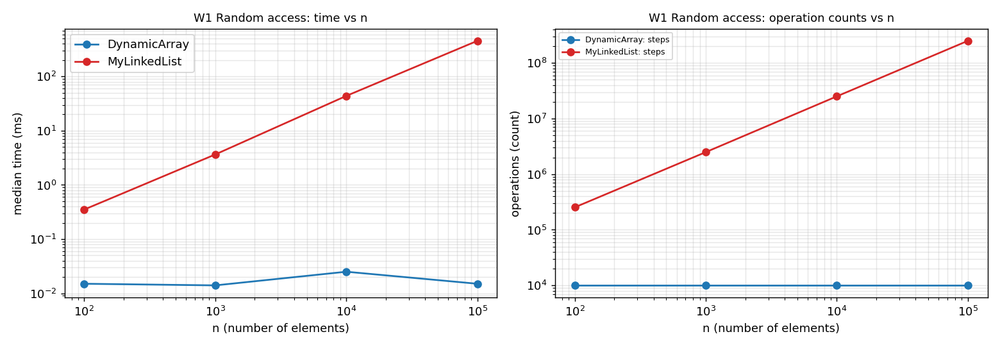
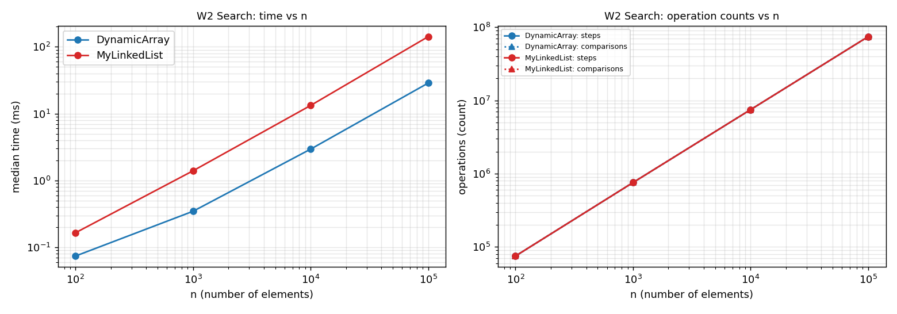
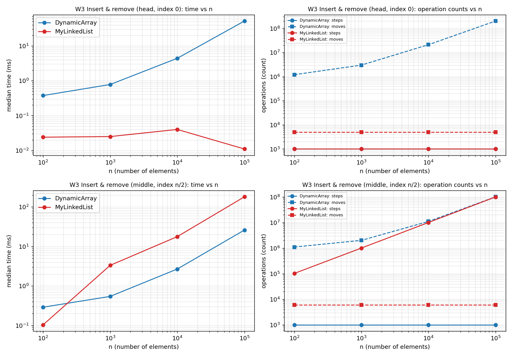
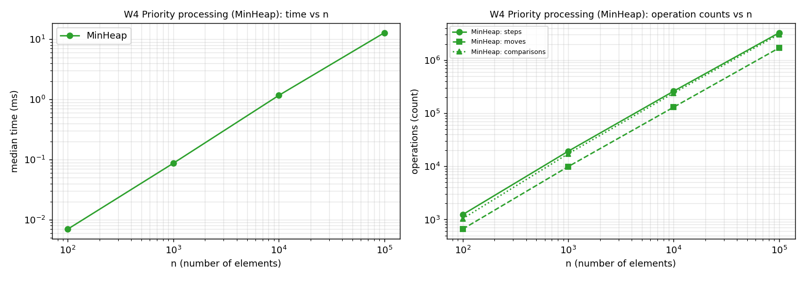
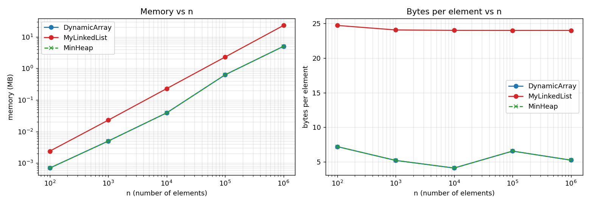
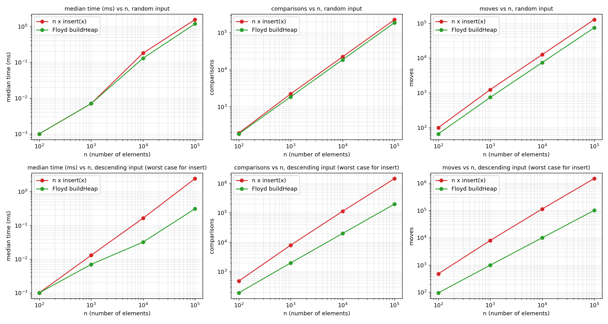

# Assignment 2 - In-Memory Workload Engine: Report

Implementation: `DynamicArray`, `MyLinkedList` (doubly linked) and `MinHeap` in Java 17, `int` storage, no `java.util` collections.
Measurements: JDK 21 (compiled with `--release 17`), `-XX:+UseSerialGC`, one vCPU container, median of 5 runs after 5 warm-up runs,
data from `new Random(42)`. n is the number of stored elements. Raw data: `results/results.csv`.

## 1. Complexity table

Every row is a single call; "amortized" is stated explicitly. Θ is used when best and worst bounds are tight, otherwise Ω/O.
Heap and array `contains`/`get` use `size = n`.

### DynamicArray (backing `int[]`, capacity doubles when full)

| Operation | Best | Average | Worst | Justification |
|---|---|---|---|---|
| `add(x)` | Θ(1) | Θ(1) amortized | Θ(n) single call | append is one write; a resize copies n elements, but resizes happen at sizes 10, 20, 40, ... so the copies sum to < 2n over n appends |
| `add(i, x)` | Θ(1) (i = n) | Θ(n) | Θ(n) (i = 0) | shifts the n - i elements after i; with i uniform the average is n/2 |
| `remove(i)` | Θ(1) (i = n-1) | Θ(n) | Θ(n) (i = 0) | shifts the n - i - 1 elements after i |
| `get(i)` | Θ(1) | Θ(1) | Θ(1) | one array read |
| `contains(x)` | Θ(1) (x at index 0) | Θ(n) | Θ(n) (x absent) | linear scan; found at a uniform position costs ~n/2, absent costs n |
| aux. space | | | | Θ(n) storage, capacity between n and 2n; O(1) extra per call, a resize needs a temporary Θ(n) array |

### MyLinkedList (doubly linked, `head` and `tail`)

| Operation | Best | Average | Worst | Justification |
|---|---|---|---|---|
| `add(x)` | Θ(1) | Θ(1) | Θ(1) | `tail` pointer: 3 link updates, no traversal |
| `add(i, x)` | Θ(1) (i = 0 or n) | Θ(n) | Θ(n) (i ≈ n/2) | walks min(i, n - i) hops from the nearer end (average n/4, worst n/2), then 3-4 link updates |
| `remove(i)` | Θ(1) (i = 0 or n-1) | Θ(n) | Θ(n) (i ≈ n/2) | same walk, then 2 link updates |
| `get(i)` | Θ(1) (ends) | Θ(n) | Θ(n) (i ≈ n/2) | same walk; measured 25 054 steps per `get` at n = 100 000, i.e. n/4 |
| `contains(x)` | Θ(1) (x is the head) | Θ(n) | Θ(n) (x absent) | linear scan along `next` |
| aux. space | | | | Θ(n): one 24-byte node per element; O(1) extra per call |

### MinHeap (array-based binary min-heap)

| Operation | Best | Average | Worst | Justification |
|---|---|---|---|---|
| `insert(x)` | Θ(1) (x ≥ parent) | Θ(1) for random keys | Θ(log n) (x is a new minimum) | bubble-up climbs at most ⌊log₂ n⌋ levels; random keys rarely climb (measured 2.28 comparisons per insert); resize amortized O(1) |
| `peekMin()` | Θ(1) | Θ(1) | Θ(1) | reads `a[0]` |
| `extractMin()` | Ω(1) (all keys equal) | Θ(log n) | Θ(log n) | the last leaf is moved to the root and sinks, usually to the bottom: ≤ ⌊log₂ n⌋ levels, 2 comparisons per level (measured ≈ 28 per call at n = 100 000) |
| `buildHeap(a)` (bonus) | Θ(n) | Θ(n) | Θ(n) | level h has ≤ n/2^(h+1) nodes that sink ≤ h levels: Σ h·n/2^(h+1) ≤ n; every internal node is examined, so Ω(n) |
| aux. space | | | | Θ(n) storage; `insert`/`extractMin` are iterative with O(1) extra space (hole technique) |

## 2. Loop-invariant proofs

### Proof 1 - `DynamicArray.contains(x)`

```java
for (int i = 0; i < size; i++) {
    if (data[i] == x) return true;
}
return false;
```

* **Invariant.** Before each evaluation of the loop condition, with counter value i (0 ≤ i ≤ size), the value x does not occur in `data[0..i-1]`.
* **Initialization.** Before the first iteration i = 0, so `data[0..-1]` is empty and contains no x.
* **Maintenance.** Assume the invariant holds for i and the body runs (i < size). If `data[i] == x` the method returns `true` and the loop ends. Otherwise `data[i] != x`, so together with the invariant x does not occur in `data[0..i]`; after `i++` this is exactly `data[0..i'-1]` for the new i' = i + 1.
* **Termination.** Each iteration increases i by 1 and the loop stops at i = size, so it ends after at most `size` iterations. If it ends because the condition fails, i = size and the invariant says x does not occur in `data[0..size-1]`, i.e. in the whole array.
* **Conclusion.** The method returns `true` only after seeing `data[i] == x`, so a `true` answer is correct. It returns `false` only when the loop ended normally, and then the invariant proves that x is not stored, so `false` is correct too. `MyLinkedList.contains` has the same invariant over the nodes before `cur`.

### Proof 2 - bubble-down in `MinHeap.siftDown(start, x)` (used by `extractMin` and `buildHeap`)

```java
int i = start;
while (true) {
    int c = 2 * i + 1;
    if (c >= size) break;                   // i is a leaf
    if (c + 1 < size && a[c + 1] < a[c]) c++;   // c = smaller child
    if (a[c] >= x) break;
    a[i] = a[c];  i = c;                    // move the child up, the hole moves down
}
a[i] = x;
```

**Precondition.** Let T be the subtree rooted at `start`. Both child subtrees of `start` are min-heaps; cell `start` is a hole and x is the value to be placed.
(For `extractMin`: `start` = 0, x = the last element, and the removed minimum is already saved.)

* **Invariant.** Before each iteration, with hole index i:
  (a) every parent-child pair of T that does not involve cell i satisfies `a[parent] <= a[child]`;
  (b) if i ≠ start, then `a[parent(i)] < x` and `a[parent(i)] <= a[c]` for both children c of i.
* **Initialization.** i = start. The pairs that do not involve `start` lie inside the two child subtrees, which are heaps by the precondition, so (a) holds. Condition (b) is vacuous because i = start.
* **Maintenance.** Assume the invariant holds and the loop does not break. Then c is the smaller child of i and `a[c] < x`. The body writes `a[i] = a[c]`, so the hole moves to c. We check (a) and (b) for the new hole c:
  * (b), first part: the parent of c is i, which now holds the old `a[c]`, and `a[c] < x` is the condition that kept the loop running.
  * (b), second part: `a[i] = a[c] <= a[d]` for each child d of c, because the pair (c, d) did not involve the old hole i, so it satisfied (a).
  * (a), the pairs that touched the old hole i but do not touch c: (parent(i), i) holds because by (b) `a[parent(i)] <= a[c]` and `a[c]` is now stored in cell i; (i, sibling of c) holds because c was the smaller child. All other pairs are unchanged.
  So the invariant holds for the new i = c.
* **Termination.** In every iteration i becomes a child index (2i+1 or 2i+2) and stays below `size`, so the loop runs at most ⌊log₂ size⌋ times. It stops in one of two ways: (1) `c >= size`: the hole i is a leaf, so no pair (i, child) exists; (2) `a[c] >= x`: x is ≤ the smaller child and therefore ≤ both children, so the pairs (i, 2i+1) and (i, 2i+2) will hold once x is in cell i.
* **Conclusion.** After the final `a[i] = x`, the pairs not involving i hold by (a), the pair (parent(i), i) holds by `a[parent(i)] < x` from (b) (or does not exist when i = start), and the pairs (i, children) hold by the exit condition (or do not exist for a leaf). Hence every parent-child pair of T satisfies the heap property and T is a min-heap. So `extractMin` returns the old root and leaves a valid heap, and `buildHeap` can call `siftDown` for nodes n/2 - 1, ..., 0 because the precondition (child subtrees are heaps) was established by the earlier calls.

## 3. Method and counters

| Counter | DynamicArray / MinHeap | MyLinkedList |
|---|---|---|
| steps | one array cell read | one node visited (start node = 1, each hop = +1) |
| moves | one element shifted or copied by a resize | one link update (`prev`/`next`, `head`/`tail`) |
| comparisons | one comparison of two elements | one comparison of two elements |

Counters are incremented inside the methods; the fill phase is reset before timing. The final write of a new element is not counted as a move.
The counters themselves cost time, equally for the structures being compared. Timings below 0.05 ms are close to the resolution of `System.nanoTime()`
and across two repeated runs two of 36 cells differed by more than 30 % (W1 list at n = 100 and W3-middle array at n = 10 000), so only large ratios should be trusted.

## 4. Plots

All charts have axis labels, units and a legend; both axes are logarithmic. Left: time vs n. Right: steps / moves / comparisons vs n (a counter that is zero for every n is omitted).

**W1 Random access** - `get(i)` is 1 step in the array and n/4 on average in the list.


**W2 Search** - identical steps and comparisons, different time.


**W3 Insert and remove** - head and middle variants.


**W4 Priority processing** - `MinHeap`, n inserts + n `extractMin`.


Selected numbers at n = 100 000 (median time, counters):

| Case | DynamicArray | MyLinkedList |
|---|---|---|
| W1 get x 10 000 | 0.015 ms, 10 000 steps | 455.4 ms, 250 540 042 steps |
| W2 contains x 1 000 | 28.6 ms, 74 253 877 steps | 141.8 ms, 74 253 877 steps |
| W3 head (1 000 ins + 1 000 rem) | 51.3 ms, 200 999 000 moves | 0.011 ms, 5 000 moves |
| W3 middle | 25.9 ms, 100 999 000 moves | 179.3 ms, 100 001 999 steps + 6 000 moves |
| W4 MinHeap | 12.8 ms, 3 059 125 comparisons | - |

## 5. Discussion

DynamicArray.get(i) always costs one step, so ten thousand random reads take 0.015 ms at n = 100 000, whereas MyLinkedList visits on average 25 054 nodes per call and needs 455 ms.
W2 isolates the memory effect: both structures performed exactly 74 253 877 steps and comparisons, yet the array finished 5.0 times faster (about 0.39 ns versus 1.9 ns per step).
The reason is spatial locality: the ints of an array are contiguous, so one 64-byte cache line delivers 16 elements and the hardware prefetcher recognises the sequential stream and loads the next lines before they are needed.
A list step must wait for the previous node's `next` pointer before the next address is even known, so the loads form a dependent chain that cannot overlap or be vectorised, and each step pays the latency of whichever cache level holds the node.
Each node also carries a 12-byte object header and two 4-byte references, so it takes 24 bytes for a 4-byte value (measured 24.0 versus 5.2 bytes per element at n = 1 000 000), which means a cache line holds two to three nodes instead of 16 ints and the list occupies several times more cache.

W3-middle repeats the lesson: at n = 100 000 the array shifted 100 999 000 elements and the list visited 100 001 999 nodes, essentially the same number of operations and the same Θ(n) per call, but the array took 25.9 ms and the list 179 ms (7 times more), because a shift is a streaming copy of neighbouring ints (about 0.26 ns) and a step is a dependent pointer load (about 1.8 ns).
Big-O and raw operation counts therefore hide the cost of one operation: two Θ(n) bounds can differ by a constant factor of several when the memory access patterns differ.
Pointer chasing is the dominant cost here, and the measured gap is a lower bound, because the JVM's bump-pointer allocator placed our nodes back to back, whereas in a long-running program nodes are allocated and freed at different times and scatter over the heap.
In addition, every list node is a separate heap object: each insertion allocates one, each removal leaves garbage, and the garbage collector has to trace (and, in a copying collector, move) 100 000 objects instead of a single `int[]` whose only allocation event is the occasional doubling.

MyLinkedList is the better choice when the workload is dominated by insertions and removals at the ends or at an already known position: for head operations at n = 100 000 it needed 5 000 link updates in 0.011 ms while the array shifted 200 999 000 elements in 51 ms (more than 4 000 times slower), which is exactly the pattern of a queue, a deque or an LRU list.
It is a poor choice for random access and search, its 6 times larger memory footprint with `int` values makes it less attractive, and middle insertion only pays off if a node reference is already held because locating the position costs Θ(n) anyway.
MinHeap is the right structure when the smallest element is needed repeatedly while new data keeps arriving (priority scheduling): W4 inserted and extracted 100 000 values in 12.8 ms with 3.06 million comparisons, about 1.8·n·log₂n, whereas a sorted DynamicArray shifts Θ(n) elements per insertion and an unsorted one scans Θ(n) per extraction.
The heap cannot answer `contains` or index queries efficiently, and when all values are known up front Floyd's `buildHeap` beats n separate inserts (next section).

## 6. Bonus tasks

### Task A - memory footprint (`results/memory.csv`, `results/plots/memory.png`)



| n | DynamicArray = MinHeap | MyLinkedList | ratio |
|---|---|---|---|
| 1 000 | 5 200 B (5.2 B/elem) | 24 072 B (24.1 B/elem) | 4.6x |
| 100 000 | 655 440 B (0.63 MB) | 2 400 072 B (2.29 MB) | 3.7x |
| 1 000 000 | 5 242 960 B (5.00 MB) | 24 000 072 B (22.9 MB) | 4.6x |

The tool measures the growth of the used heap after `System.gc()` (median of 5 trials) and compares it with the HotSpot layout; they agree to within 72 bytes, which is the wrapper object plus its `Metrics` object.
**Note:** JOL itself was not available in the environment where this report was produced, so the numbers come from this heap measurement and from the layout arithmetic; the README explains how to cross-check them with JOL.
A list node (compressed oops, default for heaps below 32 GB) is a 12-byte object header + 4-byte `value` + 4-byte `prev` + 4-byte `next` = 24 bytes, already a multiple of 8, so there is no padding; the payload is only 4 of these 24 bytes (17 %), the remaining 83 % is header and pointers.
Without compressed oops the node becomes 16 + 4 + 8 + 8 = 36, rounded up to 40 bytes. The array stores 4 bytes per slot plus a 16-byte header; its per-element cost is 4 bytes times the capacity-to-size ratio (1 to 2), hence the 4.1-7.2 bytes per element in the table at different n (the capacity is a power of two times 10).

### Task B - O(n) `buildHeap` (`results/buildheap.csv`, `results/plots/buildheap.png`)



| Input, n = 100 000 | n x `insert` | Floyd `buildHeap` |
|---|---|---|
| random: time / comparisons | 1.54 ms / 227 662 | 1.18 ms / 188 424 |
| descending: time / comparisons | 2.46 ms / 1 468 946 | 0.31 ms / 199 978 |

Floyd's method starts at the last internal node and sinks every node: half of the nodes are leaves (cost 0), a quarter sink at most one level, an eighth at most two, and so on, so the total is Σ h·n/2^(h+1) ≤ n sink steps, i.e. ≤ 2n comparisons (measured 1.88n and 2.0n).
Repeated insertion costs Θ(log n) per element in the worst case: for descending input every new key becomes the new minimum and climbs to the root, giving 1 468 946 ≈ n·log₂n comparisons (7.3 times more than Floyd, and 7.9 times more time).
On random input the two are close (1.2 times), because a random key usually stops after about two comparisons - the average cost of `insert` is O(1) - so the asymptotic gap Θ(n) versus Θ(n log n) is a worst-case gap and only shows when the input is adversarial or sorted.

## 7. Tests and Git

44 JUnit 5 tests: a shared contract class (`IntListContractTest`) runs the same cases on both lists (empty, one element, duplicates, first/last index, invalid indices, 20 000 random operations compared with `java.util.ArrayList`, counters present for every operation), `MinHeapTest` checks the heap property after every insert and extraction, sorted output of n extractions, interleaved operations against `PriorityQueue`, exceptions, and `buildHeap`.
Branches `feature/array`, `feature/list`, `feature/heap`, `feature/metrics` were merged into `main` and `main` is tagged `v1.0`.
